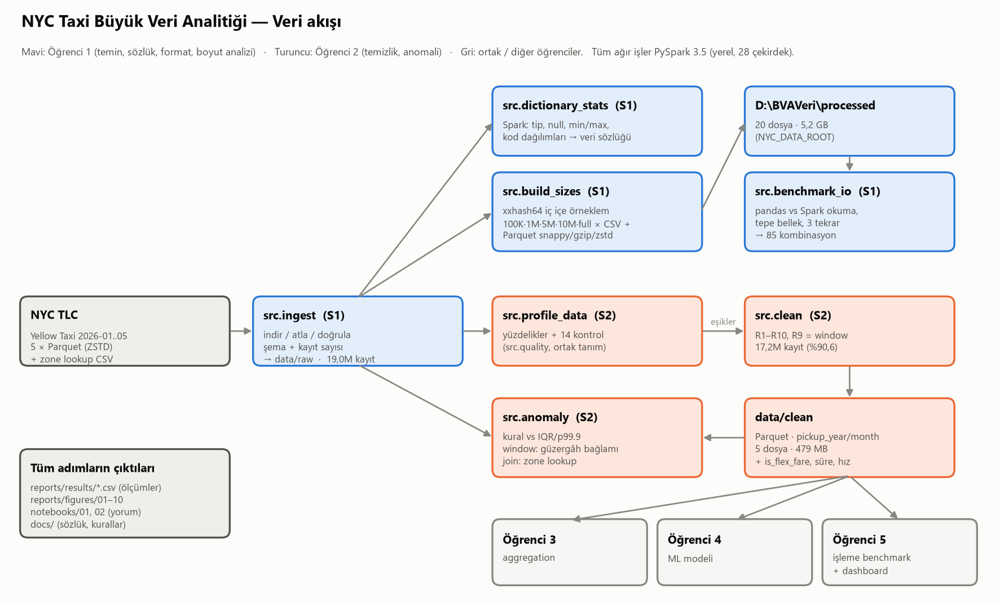

# NYC Taxi Büyük Veri Analitiği

Milyonlarca taksi yolculuğundan şehir içi ulaşım davranışlarını analiz eden bir büyük veri projesi.

> **Araştırma sorusu:** Veri büyüdükçe klasik analiz yaklaşımı (tek makinede pandas + CSV) ne zaman yetersiz kalıyor, ve neden?

| Öğrenci | Görev | Durum |
|---|---|---|
| **Öğrenci 1** | Veriyi temin eder, veri sözlüğünü hazırlar, CSV/Parquet dönüşümünü ve veri büyüklüğü analizini yapar | ✅ |
| **Öğrenci 2** | Eksik/hatalı kayıtları temizler; anormal mesafe, ücret ve süre değerlerini analiz eder | ✅ |
| Öğrenci 3 | Saat / gün / bölge / ödeme türü aggregation analizleri | — |
| Öğrenci 4 | ML modeli | — |
| Öğrenci 5 | Pandas vs Spark işleme performansı + dashboard | — |

---

## 0. Takım için hızlı başlangıç

**Depo:** https://github.com/ismailesatucmak/BVA_Project

```powershell
# 1) Klonla (proje yolunda Türkçe karakter OLMASIN — Spark/Hadoop Windows'ta bozuluyor)
git clone https://github.com/ismailesatucmak/BVA_Project.git
cd BVA_Project

# 2) Ortam (önce Java 17 + winutils kurulu olmalı → §3)
python -m venv .venv
.\.venv\Scripts\activate
pip install -r requirements.txt
python scripts/smoke_test_spark.py        # sonunda "TÜM TESTLER BAŞARILI" görmelisiniz

# 3) Temiz veriyi al (Öğrenci 3/4/5'in girdisi) — Release'den 479 MB indirir, doğrular, data/clean'e açar
python -m src.fetch_data
```

```python
# 4) Kullan
from src.spark_session import get_spark
df = get_spark().read.parquet("data/clean")    # 17.210.961 kayıt
```

**Veri nerede, nasıl alınır?** Veri dosyaları Git'te **yok** (`data/` `.gitignore`'da; tek dosyalar GitHub'ın 100 MB sınırını aşıyor).

| Veri | Boyut | Nasıl alınır |
|---|---|---|
| Temiz veri `data/clean` | 479 MB | `python -m src.fetch_data` → [Release `data-v1`](https://github.com/ismailesatucmak/BVA_Project/releases/tag/data-v1) eki, SHA-256 + satır sayısı doğrulamalı. Elle indirirseniz zip'i `data/clean/` içine açın (içinde `pickup_year=2026/` olmalı). |
| Ham veri `data/raw` | 310 MB | `python -m src.ingest` → resmi TLC kaynağından indirir ve doğrular |
| Boyut setleri (100K…19M × 4 format) | 5,2 GB | `python -m src.build_sizes` (~12 dk). Yalnızca format/boyut deneyi yapacaksanız gerekir (Öğrenci 5) |
| Ölçüm sonuçları, grafikler | küçük | Depoda: `reports/results/*.csv`, `reports/figures/*.png` |

Temiz veriyi kendiniz üretmek isterseniz: `python -m src.ingest` → `python -m src.clean` (~3 dk + indirme). Sonuç birebir aynıdır.

**Kendi bölümünüzü eklerken:** kodu `src/` altına, notebook'u `notebooks/03_…`, `04_…`, `05_…` olarak, sonuçları `reports/results/`, grafikleri `reports/figures/11_…` ve sonrası olarak koyun; README'de kendi bölümünüzü (§8–10) doldurun. Yeni eşikleri `src/config.py`'ye, Spark oturumunu her zaman `get_spark()` ile açın. Claude Code kullanıyorsanız [`CLAUDE.md`](CLAUDE.md) projeyi ona otomatik tanıtır.

---

## 1. Veri

- **Kaynak:** [NYC TLC Trip Record Data](https://www.nyc.gov/site/tlc/about/tlc-trip-record-data.page) — Yellow Taxi, **2026 Ocak–Mayıs**
- **18.999.282 kayıt**, 20 kolon, 5 Parquet dosyası (310 MB, ZSTD) + taxi zone lookup (265 bölge)
- Gerçek veri yeterince büyük olduğu için sentetik çoğaltma yapılmadı.
- Kolon kolon açıklama, birim, kod tabloları ve gözlenen istatistikler: [`docs/data_dictionary.md`](docs/data_dictionary.md)

## 2. Mimari



TLC'den indirilen ham Parquet dosyaları iki koldan işlenir. **Öğrenci 1** veriyi 5 boyutta (100K → 19M) ve 4 formatta (CSV, Parquet snappy/gzip/zstd) yeniden yazar ve pandas ile Spark'ın okuma süresini ve bellek kullanımını ölçer. **Öğrenci 2** veriyi profiller ve kural bazlı temizler; çıkan temiz veri (`data/clean`) Öğrenci 3/4/5'in ortak girdisidir. Tüm ağır işler PySpark 3.5 ile yapılır. Şemayı yeniden üretmek için: `python scripts/make_architecture.py`.

## 3. Kurulum (Windows)

| Bileşen | Sürüm | Not |
|---|---|---|
| Python | 3.11 | |
| Java | Temurin JDK 17 | varsayılan `C:\tools\jdk-17`; farklıysa `NYC_JAVA_HOME` ortam değişkeni |
| Hadoop Windows araçları | `winutils.exe` + `hadoop.dll` 3.3.6 | `C:\tools\hadoop\bin`; farklıysa `HADOOP_HOME` — Spark'ın Windows'ta dosya yazabilmesi için gerekli |
| Python paketleri | `requirements.txt` | PySpark 3.5.9, pandas 2.3 (pandas 3 PySpark 3.5 ile uyumsuz), pyarrow |

```powershell
python -m venv .venv
.\.venv\Scripts\activate
pip install -r requirements.txt
python scripts/smoke_test_spark.py      # Spark kurulum testi
```

- Büyük çıktılar (boyut setleri 5,2 GB, Spark geçici dosyaları) için kök klasör sırasıyla: `NYC_DATA_ROOT` ortam değişkeni → `D:\BVAVeri` (varsa; Öğrenci 1'in ölçümleri burada alındı) → proje içindeki `data/large`. Örn. `$env:NYC_DATA_ROOT = "E:\veri"`.
- Bilgisayar adı alt çizgi içeriyorsa (örn. `Ismail_Esat`) Spark URL'si geçersiz olur; `src/spark_session.py` bunu `localhost` ile çözer. Her yerde `get_spark()` kullanılır.

## 4. Çalıştırma sırası

| # | Komut | Ne yapar | Süre* |
|---|---|---|---|
| 1 | `python -m src.ingest` | eksik dosyaları TLC'den indirir (310 MB), var olanları doğrular | bağlantıya bağlı |
| 2 | `python -m src.dictionary_stats` | veri sözlüğü istatistikleri (Spark) | ~1 dk |
| 3 | `python -m src.build_sizes` | 5 boyut × 4 format = 20 dosya | ~12 dk |
| 4 | `python -m src.benchmark_io` · `--startup` | okuma süresi + bellek ölçümü (85 kombinasyon, 3 tekrar) | ~45 dk |
| 5 | `python -m src.profile_data` | ham veri profili + 14 tutarlılık kontrolü | ~1 dk |
| 6 | `python -m src.clean` | temizlik → `data/clean` | ~2 dk |
| 7 | `python -m src.anomaly` | anomali analizi (window + join) | ~3 dk |
| 8 | `notebooks/01_*.ipynb`, `notebooks/02_*.ipynb` | grafikler ve yorum | — |

\* 28 çekirdek, 16 GB RAM, NVMe SSD. Her script kaldığı yerden devam eder veya sonucu yeniden üretir.
Yalnızca temiz veri gerekiyorsa bu tablonun yerine `python -m src.fetch_data` yeterlidir (§0).

**Testler:** `python -m pytest tests` (75 test; Spark testleri tek çekirdekle çalışır, ~2 dk).

## 5. Klasör yapısı

```
src/            ingest, dictionary_stats, build_sizes, benchmark_io, plots_io        (Öğrenci 1)
                quality, profile_data, clean, anomaly, plots_clean                    (Öğrenci 2)
                config (yollar + eşikler), spark_session (Windows ayarları),
                fetch_data (temiz veriyi Release'den kurar)                           (ortak)
notebooks/      01_data_acquisition_and_formats, 02_cleaning_and_anomalies
reports/        results/*.csv (tüm ölçümler) · figures/01–10_*.png
docs/           ROADMAP, data_dictionary, cleaning_rules, technical_report_s1_s2,
                exam_questions_s1_s2, PROJECT_REQUIREMENTS, architecture.png
data/           raw/ (TLC) · clean/ (temiz veri) · samples/ — Git'e girmez
tests/          pytest
```

---

## 6. Öğrenci 1 — Veri temini, sözlük, format dönüşümü, veri büyüklüğü analizi

**Notebook:** [`notebooks/01_data_acquisition_and_formats.ipynb`](notebooks/01_data_acquisition_and_formats.ipynb)

| İş | Dosya | Teknik ayrıntı |
|---|---|---|
| Veri temini | `src/ingest.py` | eksik dosyayı indirir, yarım inen dosya bırakmaz (`.part` → yeniden adlandırma), şema ve kayıt sayısını doğrular |
| Veri sözlüğü | `src/dictionary_stats.py` → `docs/data_dictionary.md` | 19M kayıt üzerinde Spark ile tip, null, min/max, kod dağılımları; resmi PDF ile birleştirildi |
| Format dönüşümü | `src/build_sizes.py` | 100K / 1M / 5M / 10M / full; **xxhash64 tabanlı iç içe örneklem** (makineden bağımsız, 100K ⊂ 1M ⊂ … ⊂ full); her boyut × format tek dosya |
| Boyut analizi | `src/benchmark_io.py` | pandas vs Spark; tam ve 3 kolonluk okuma; her pandas ölçümü ayrı süreçte (tepe bellek); Spark `noop` yazımıyla tetiklenir (`count()` Parquet'te veriyi okumaz) |
| Grafikler | `src/plots_io.py` | `reports/figures/01–05` |

**Sonuçlar (19M kayıt):**

| | Disk | Okuma | Okurken en yüksek RAM |
|---|---|---|---|
| pandas + CSV | 1.907 MB | **71,1 sn** | **9,4 GB (%59)** |
| pandas + Parquet (zstd) | 290 MB | 2,0 sn | 6,6 GB |
| Spark + CSV (oturum açılışı hariç) | 1.907 MB | 8,1 sn | — |
| Spark + Parquet (snappy) | 392 MB | 3,7 sn | — |

- Parquet diskte CSV'den **4,9–6,6 kat küçük**; pandas ile **~40 kat hızlı** okunur.
- Spark oturum açılışı (11,4 sn) dahil edilince pandas + CSV, **~3,6M kayıttan** sonra Spark'ın gerisine düşer.
- pandas tepe belleği satır başına ~0,5 KB ile doğrusal artar → bu makinede **~32M kayıtta RAM tükenir**.
- **Cevap:** Bu ölçekte en büyük kazanç formattan gelir (CSV → Parquet). Klasik yaklaşımın sert sınırı ise bellektir; RAM'e sığmayan veride Spark zorunludur.

## 7. Öğrenci 2 — Temizlik ve anomali analizi

**Notebook:** [`notebooks/02_cleaning_and_anomalies.ipynb`](notebooks/02_cleaning_and_anomalies.ipynb) · **Kurallar:** [`docs/cleaning_rules.md`](docs/cleaning_rules.md)

| İş | Dosya | Teknik ayrıntı |
|---|---|---|
| Ortak kontroller | `src/quality.py` | türetilmiş kolonlar + 14 mantıksal kontrol; profil, temizlik ve anomali aynı tanımları kullanır |
| Profil | `src/profile_data.py` | 19M kayıtta yüzdelikler (p0,1–p99,9) ve kontrol sayıları, Flex Fare kırılımıyla |
| Temizlik | `src/clean.py` | 10 kural; her kural için tek başına / sıralı / yalnız bu kural etkisi; R9 duplicate **window** (`row_number`) |
| Anomali | `src/anomaly.py` | kural vs IQR / p99,9; güzergâh bağlamı **window** (`partitionBy(PU, DO)`); zone lookup **join** ile örüntü |
| Grafikler | `src/plots_clean.py` | `reports/figures/06–10` |

**Sonuçlar:**
- **Eksik veri sistematik:** null'ların tamamı `payment_type = 0` (Flex Fare) kayıtlarında (%25,3). Naif `dropna()` bu kayıtların hepsini silerdi; null tek başına silme nedeni sayılmadı, doldurma yapılmadı.
- **18.999.282 → 17.210.961 kayıt (%90,6 korundu).** Kurallar örtüşüyor: tek başına toplam 2,09M, sıralı toplam 1,79M.
- Temizlik ortalamaları değiştirir, medyanları değiştirmez: mesafe ortalaması 5,74 → 3,25 mil, medyan 1,83 → 1,84.
- **Kural ≠ istatistik:** R3 (ücret ≤ 0) ile p99,9 eşiği arasında örtüşme sıfır; global IQR ağır kuyruklu taksi ücretlerinde 1,25M meşru kaydı anomali sayıyor.
- **Bağlam:** güzergâh bazlı analiz, global eşiğin 15 katı ücret anomalisi buluyor (örn. aynı bölge içinde 0,15 mil için 650 $).
- **Hataların kaynağı sağlayıcılar:** Helix iniş zamanını göndermiyor (kayıtlarının tamamı silindi), Creative Mobile tarife kodunu göndermiyor, iadeler Curb'ün ters kayıtları.

**Temiz veri (Öğrenci 3/4/5 için):**
```python
from src.spark_session import get_spark
df = get_spark().read.parquet("data/clean")   # 17,2M kayıt; pickup_year/pickup_month partition
```
Şema ve garanti edilen koşullar: [`docs/data_dictionary.md` §8](docs/data_dictionary.md). Flex Fare kayıtlarında (`is_flex_fare = True`) 5 kolon null'dur.

## 8. Öğrenci 3 — Aggregation analizleri
*(Öğrenci 3 dolduracak)*

## 9. Öğrenci 4 — ML modeli
*(Öğrenci 4 dolduracak)*

## 10. Öğrenci 5 — İşleme performansı ve dashboard
*(Öğrenci 5 dolduracak. Öğrenci 1'in boyut setleri `D:\BVAVeri\processed\size_*` altında kullanıma hazır.)*

---

## Belgeler
- [Kısa teknik rapor — Öğrenci 1 ve 2](docs/technical_report_s1_s2.md)
- [Sınav soruları — Öğrenci 1 ve 2](docs/exam_questions_s1_s2.md)
- [Yol haritası ve kararlar](docs/ROADMAP.md) · [Proje gereksinimleri](docs/PROJECT_REQUIREMENTS.md)
